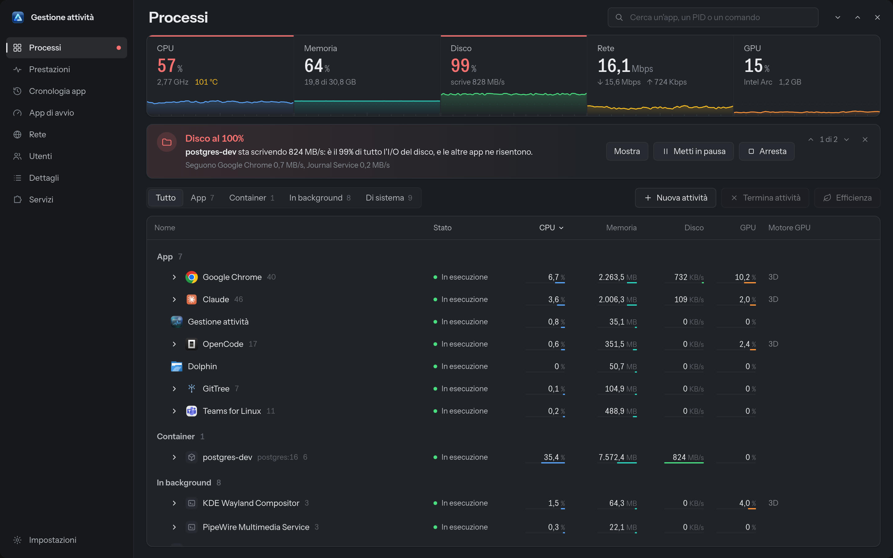
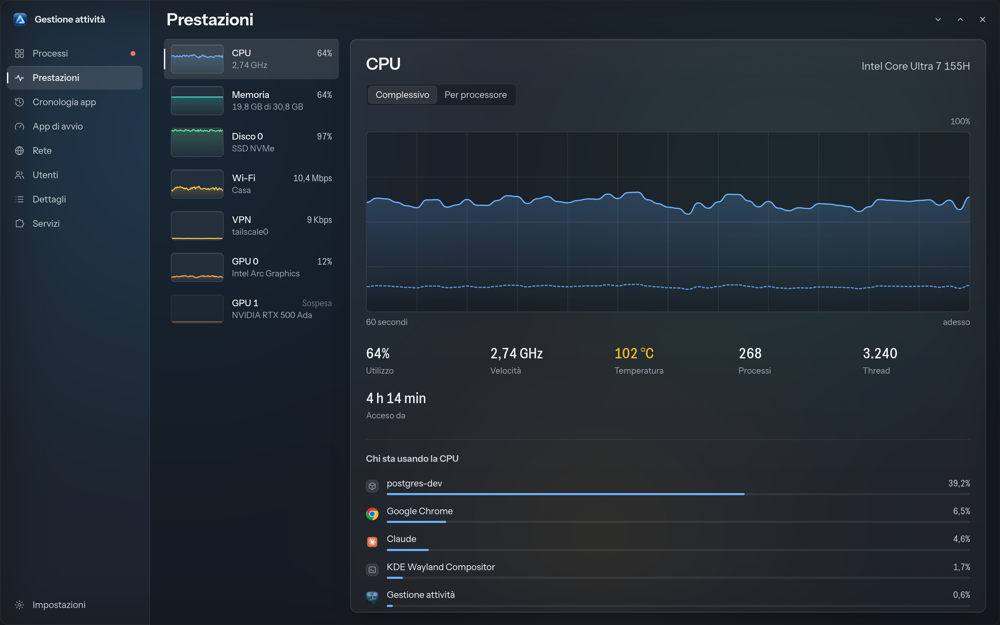
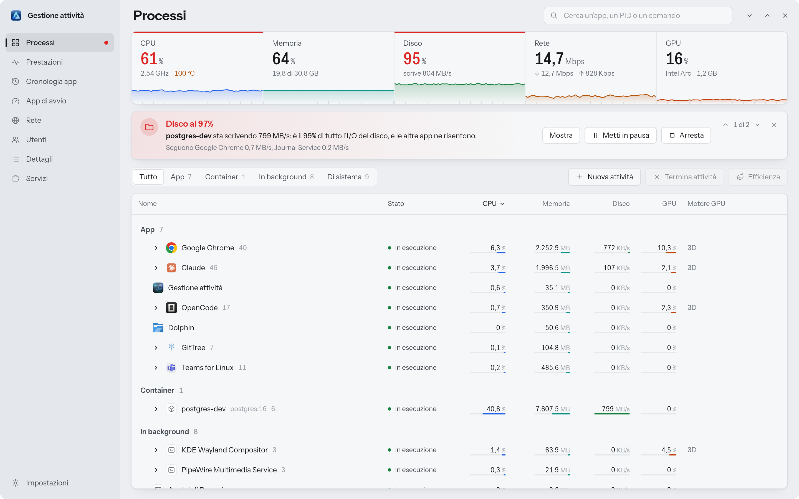
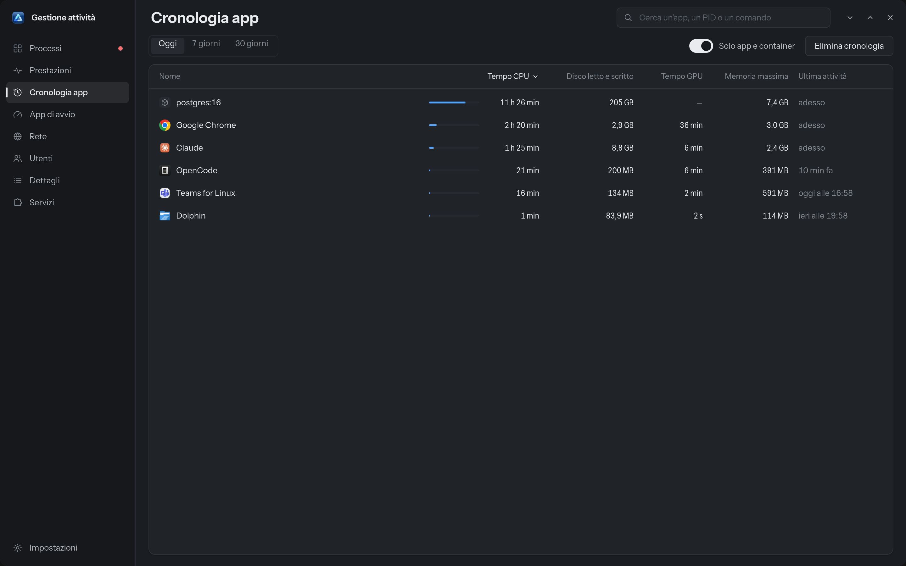
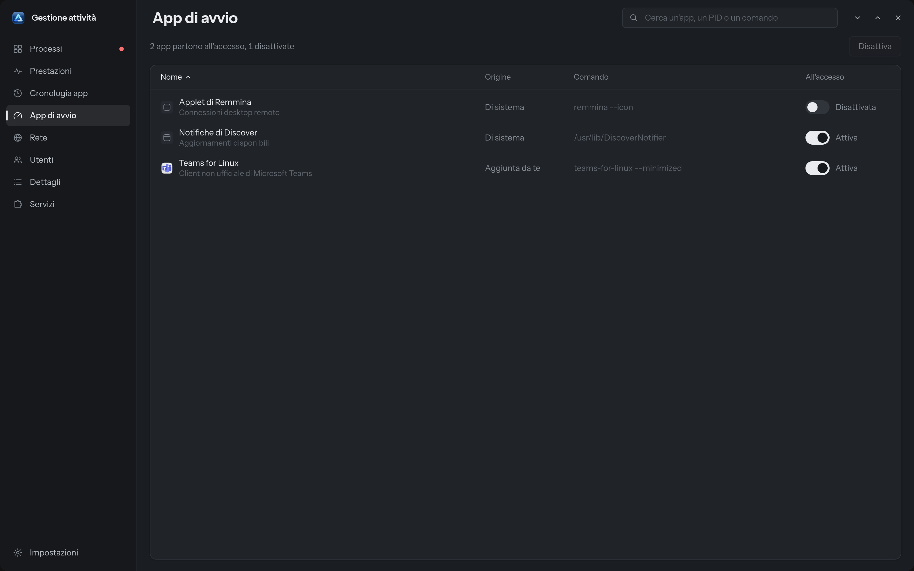
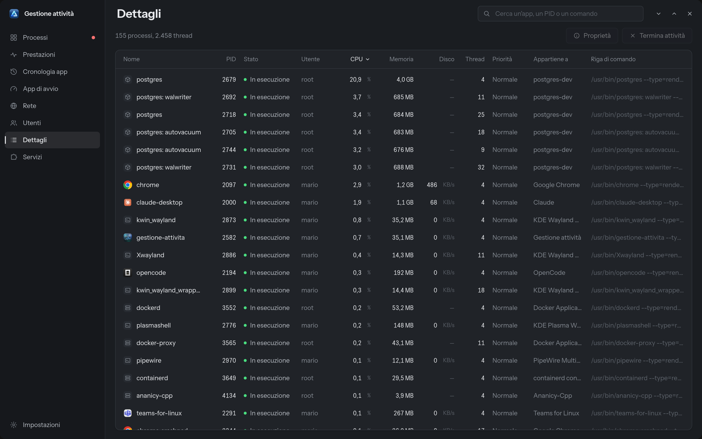
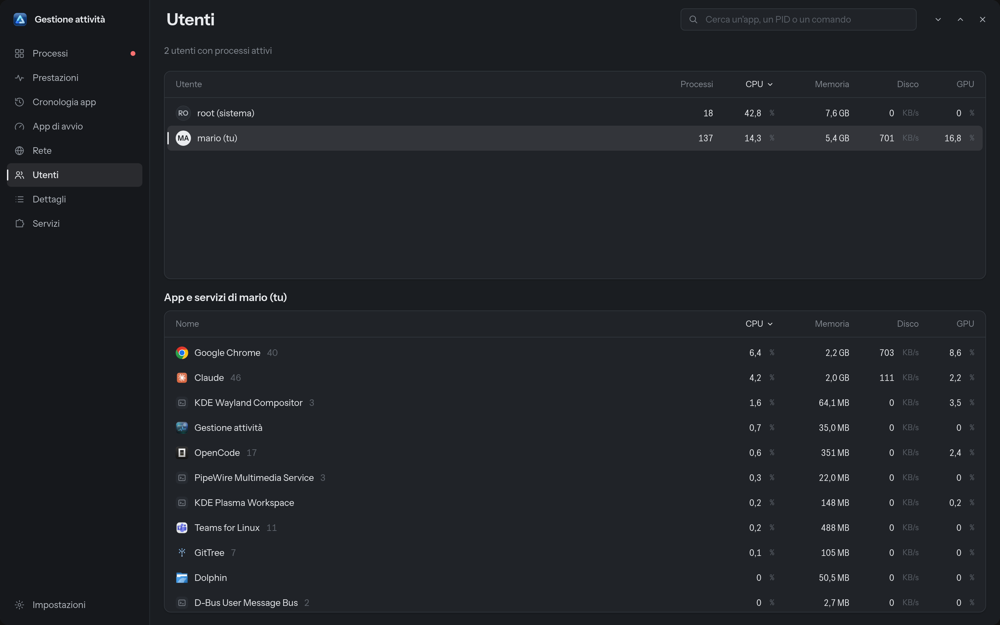
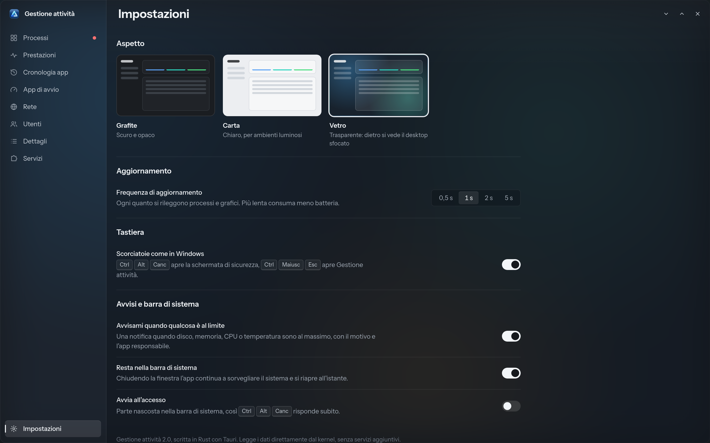
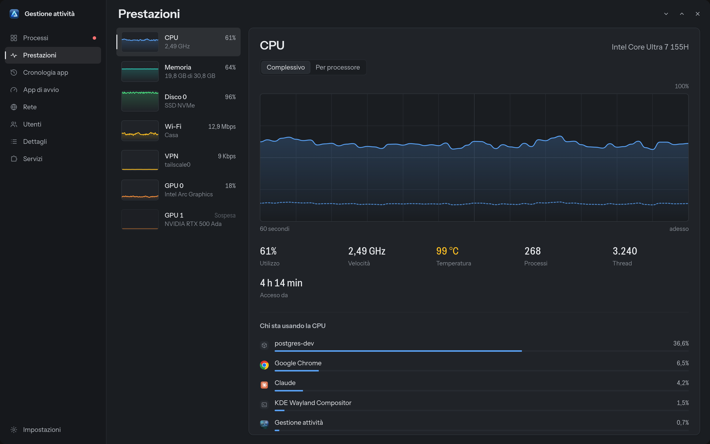

<p align="center">
  
</p>

<h1 align="center">Gestione attività</h1>

<p align="center">
  Il Task Manager di Windows, rifatto per Linux e KDE Plasma.<br>
  <strong>Ctrl+Alt+Canc</strong> e <strong>Ctrl+Maiusc+Esc</strong> funzionano come ti aspetti, e quando qualcosa è al 100% ti dice subito perché.
</p>

<p align="center">
  <a href="https://github.com/giannoccarol/Activity-manager-linux/releases/latest"></a>
  
  
</p>

<p align="center">
  
</p>

> **In English:** a Windows-style task manager for Linux (KDE Plasma 6, Wayland), written in Rust + Tauri 2 with a Svelte 5 UI. Ctrl+Alt+Del opens a Windows-like security screen, Ctrl+Shift+Esc opens the app. Processes are grouped by app, container and service; when CPU, disk, memory or temperature hit the limit it tells you which app is responsible and offers a one-click fix. Real KWin background blur, app history, startup apps, per-app network, users, details and systemd services. The UI is in Italian.

---

## Perché

Su Windows, quando il computer rallenta, premi Ctrl+Alt+Canc e in due secondi vedi chi sta consumando cosa. Su Linux gli strumenti ci sono, ma sono sparsi tra terminale e monitor di sistema, e nessuno risponde alla domanda che conta: **perché** il disco è al 100%?

Gestione attività mette tutto in una finestra familiare, legge i dati direttamente dal kernel e ragiona su di essi:

> **Disco al 97%**: **postgres-dev** sta scrivendo 845 MB/s, il 99% di tutto l'I/O del disco, e le altre app ne risentono.
> &nbsp;&nbsp;&nbsp;&nbsp;`Mostra` · `Metti in pausa` · `Arresta`

## Cosa fa

**Le due scorciatoie di Windows**
- **Ctrl+Alt+Canc** apre una schermata a tutto schermo su ogni monitor: Blocca, Cambia utente, Esci, Gestione attività, più Sospendi, Riavvia e Arresta.
- **Ctrl+Maiusc+Esc** apre l'app, o la riporta in primo piano anche se è ridotta a icona (con il permesso di attivazione di Wayland).

**Processi**
- Raggruppati come in Windows: **App**, **Container** (Docker e Podman, con nome e immagine), **In background**, **Di sistema**. Il raggruppamento usa i cgroup di systemd, quindi un'app con 40 processi resta una riga sola.
- CPU, memoria, disco e GPU per gruppo e per processo, con il motore GPU in uso (3D, video, copia…).
- Ricerca per nome, PID o riga di comando. Ordinamento per colonna, con le righe che scivolano nella nuova posizione.
- Azioni: termina, termina forzatamente, sospendi e riprendi, **modalità efficienza** (priorità CPU e I/O minime), apri il percorso, copia la riga di comando, proprietà. Sui container: pausa, riavvio, log e shell nel terminale.
- Per i processi di altri utenti chiede la password con la finestra di sistema (pkexec), invece di fallire in silenzio.

**Diagnosi**
- Disco, memoria, CPU, temperatura e GPU al limite: individua l'app responsabile, dice quanto pesa sul totale e propone l'azione giusta (pausa per un container, efficienza o chiusura per un'app).
- Se l'app resta nella barra di sistema, ti avvisa anche con una notifica, al massimo ogni 30 minuti, con "Ignora per 2 ore".

**Prestazioni**
- CPU complessiva e per core, frequenza e temperatura; memoria e swap; ogni disco con letture e scritture; ogni rete con il nome Wi-Fi; ogni GPU (Intel, AMD, NVIDIA).
- La GPU NVIDIA dei portatili ibridi **non viene mai svegliata** solo per leggerne lo stato.
- Per ogni risorsa, l'elenco di chi la sta usando.

**Le altre pagine, come in Windows**
- **Cronologia app**: tempo CPU, disco, GPU e memoria massima per app, oggi, negli ultimi 7 o 30 giorni (SQLite locale).
- **App di avvio**: attiva e disattiva le app che partono all'accesso, come le Impostazioni di sistema di KDE.
- **Rete**: velocità per app e verso quali indirizzi, più lo stato delle interfacce.
- **Utenti**: consumo per utente e le sue app.
- **Dettagli**: tutti i processi in un elenco piatto, con PID, utente, thread, priorità e riga di comando.
- **Servizi**: servizi systemd di sistema e dell'utente; avvia, arresta, riavvia, avvio automatico, registro.

**Aspetto**
- Tre temi minimali: **Grafite** (scuro), **Carta** (chiaro), **Vetro**. Il Vetro usa una finestra trasparente con la **sfocatura reale di KWin** su ciò che sta dietro (protocollo Wayland `ext-background-effect-v1`), non un'immagine di sfondo.
- Pulsanti della finestra a destra come in KDE, angoli arrotondati con un contorno sottile.
- Animazioni brevi e curate: indicatori che scorrono tra le voci, pagine che entrano, righe che si riordinano, numeri che salgono. Quelle legate agli aggiornamenti girano solo con la finestra in primo piano.

**Leggera**

Misurata sull'app installata, con l'aggiornamento ogni secondo:

| | Consumo (Intel Core Ultra 7 155H) |
|---|---|
| Finestra aperta, in primo piano, con le animazioni | circa 20% di un core |
| Finestra aperta, non in primo piano | circa 10% |
| Nascosta nella barra di sistema | meno dell'1% |

## Screenshot

Gli screenshot usano dati dimostrativi.

| | |
|---|---|
|  |  |
| **Processi**, tema Grafite | **Prestazioni**, tema Vetro |
|  |  |
| **Ctrl+Alt+Canc** | **Processi**, tema Carta |
|  |  |
| **Cronologia app** | **Rete** |
|  |  |
| **Servizi** | **App di avvio** |
|  |  |
| **Dettagli** | **Utenti** |
|  |  |
| **Impostazioni** | **Prestazioni**, tema Grafite |

## Requisiti

- **KDE Plasma 6 su Wayland** (consigliato). Le scorciatoie globali e il tema Vetro sono pensati per KDE; il resto funziona anche altrove.
- Librerie di sistema:

| Distribuzione | Pacchetti |
|---|---|
| Arch, CachyOS, Manjaro | `webkit2gtk-4.1 gtk3 libayatana-appindicator libnotify` |
| Fedora | `webkit2gtk4.1 gtk3 libayatana-appindicator-gtk3 libnotify` |
| Debian, Ubuntu | `libwebkit2gtk-4.1-0 libgtk-3-0 libayatana-appindicator3-1 libnotify-bin` |

Facoltativi: `docker` o `podman` per i container, `nvidia-utils` per i dati della GPU NVIDIA, `librsvg` per le icone PNG.

## Installazione

### Dalla release

Il binario della release è compilato su Arch Linux (x86_64) e richiede glibc 2.39 o più recente (Ubuntu 24.04, Fedora 40, Debian 13 e successive). Su distribuzioni più vecchie, compila dai sorgenti.

```bash
tar xf gestione-attivita-2.0.0-linux-x86_64.tar.gz
cd gestione-attivita-2.0.0-linux-x86_64
./install.sh
```

Lo script installa tutto nella tua home, senza `sudo`:
- l'app in `~/.local/share/gestione-attivita/bin`, con un collegamento in `~/.local/bin`;
- le voci di menu e l'icona;
- l'avvio all'accesso nella barra di sistema, così Ctrl+Alt+Canc risponde all'istante;
- le scorciatoie Ctrl+Alt+Canc e Ctrl+Maiusc+Esc. Ctrl+Alt+Canc viene tolto da "Esci" di KDE, e una copia di `kglobalshortcutsrc` resta come backup.

### Dai sorgenti

Servono [Rust](https://rustup.rs) 1.80 o più recente, Node.js 20 o più recente e le librerie di sviluppo di WebKitGTK 4.1 ([prerequisiti di Tauri](https://tauri.app/start/prerequisites/)).

```bash
git clone https://github.com/giannoccarol/Activity-manager-linux.git
cd Activity-manager-linux
npm install
npx tauri build
./install.sh
```

### Disinstallazione

```bash
./uninstall.sh
```

Riporta Ctrl+Alt+Canc a "Esci" di KDE. Cronologia e impostazioni restano in `~/.local/share/gestione-attivita` e `~/.config/gestione-attivita`.

## Come funziona

```
┌──────────────────────────── backend Rust ────────────────────────────┐
│ /proc, cgroup v2, /sys (dischi, rete, hwmon), DRM fdinfo (GPU)       │
│ systemd, docker/podman, ss, file .desktop e tema di icone            │
│        │                                                             │
│  raccolta ogni secondo ──► diagnosi ──► istantanea leggera ──────────┼──► evento "snapshot"
│        │                                                             │
│  cronologia (SQLite) · avvisi · barra di sistema · scorciatoie KDE   │
└──────────────────────────────────────────────────────────────────────┘
                                                        │
┌──────────────────────── interfaccia Svelte 5 ─────────▼──────────────┐
│ stato non reattivo in profondità ($state.raw) · tabelle virtualizzate │
│ grafici SVG · animazioni solo su trasformazioni e opacità            │
└──────────────────────────────────────────────────────────────────────┘
```

- **Niente servizi aggiuntivi**: l'app legge direttamente i file del kernel, non serve un demone con privilegi.
- **Raggruppamento per app**: ogni processo viene ricondotto alla sua unità systemd (`app-…scope`, `….service`, `docker-….scope`), poi al file `.desktop` per nome e icona.
- **Diagnosi**: per il disco confronta l'I/O dei cgroup con quello del dispositivo; per la temperatura cerca chi usa la CPU; per la memoria guarda anche lo swap in corso.
- **Leggerezza**:
  - i campi che non cambiano (nome, comando, icona) arrivano all'interfaccia una volta sola;
  - a finestra nascosta la raccolta rallenta a un campione ogni 3 secondi;
  - le tabelle lunghe disegnano solo le righe visibili;
  - nessuna animazione infinita, perché col vetro KWin ricalcolerebbe la sfocatura a ogni fotogramma.
- **Wayland**: la schermata Ctrl+Alt+Canc va a tutto schermo su ogni monitor tramite GTK; la sfocatura usa `ext-background-effect-v1`; il permesso di attivazione (`XDG_ACTIVATION_TOKEN`) passa dalla nuova istanza a quella già aperta.

## Sviluppo

```bash
npm run dev          # interfaccia nel browser con dati dimostrativi (http://localhost:1420)
npx tauri dev        # app completa con dati reali
```

Opzioni utili dell'eseguibile:

| Opzione | Effetto |
|---|---|
| `--tray` | parte nascosta nella barra di sistema |
| `--secure` | apre la schermata Ctrl+Alt+Canc |
| `--dump` | stampa un'istantanea dei dati in JSON ed esce |
| `--bench` | misura fluidità, cambio pagina, ricerca, scorrimento e consumo; risultati in `~/.cache/gestione-attivita/bench.txt` |
| `--apply-shortcuts`, `--remove-shortcuts` | assegna o toglie le scorciatoie di KDE |

Struttura:

```
src/                 interfaccia (Svelte 5, TypeScript)
  pages/             una pagina per voce del menu, più la schermata Ctrl+Alt+Canc
  components/        tabella processi, grafici, menu, finestre di dialogo…
  lib/               stato, formattazione italiana, animazioni, misura
src-tauri/src/
  collect/           processi, sistema (CPU, memoria, dischi, rete), GPU
  extra/             cronologia, rete per app, app di avvio, servizi
  insights.rs        diagnosi ("perché è al 100%")
  actions.rs         terminare, sospendere, efficienza, container…
  blur.rs            sfocatura reale di KWin
  session.rs         blocca, cambia utente, esci, alimentazione
  settings.rs        impostazioni, scorciatoie KDE, avvio automatico
```

## Privacy

Tutto resta sul tuo computer: l'app non usa la rete e non invia dati a nessuno. La cronologia è un file SQLite in `~/.local/share/gestione-attivita/history.sqlite`.
