<p align="center">
  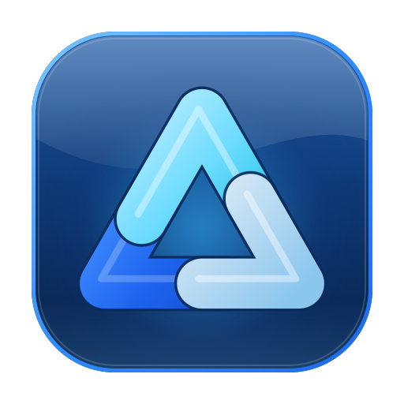
</p>

<h1 align="center">Activity Manager</h1>

<p align="center">
  The Windows Task Manager, rebuilt for Linux and KDE Plasma.<br>
  <strong>Ctrl+Alt+Del</strong> and <strong>Ctrl+Shift+Esc</strong> work the way you expect, and when something hits 100% it tells you why.
</p>

<p align="center">
  <a href="https://github.com/giannoccarol/Activity-manager-linux/releases/latest"></a>
  <a href="LICENSE"></a>
  
  
</p>

<p align="center">
  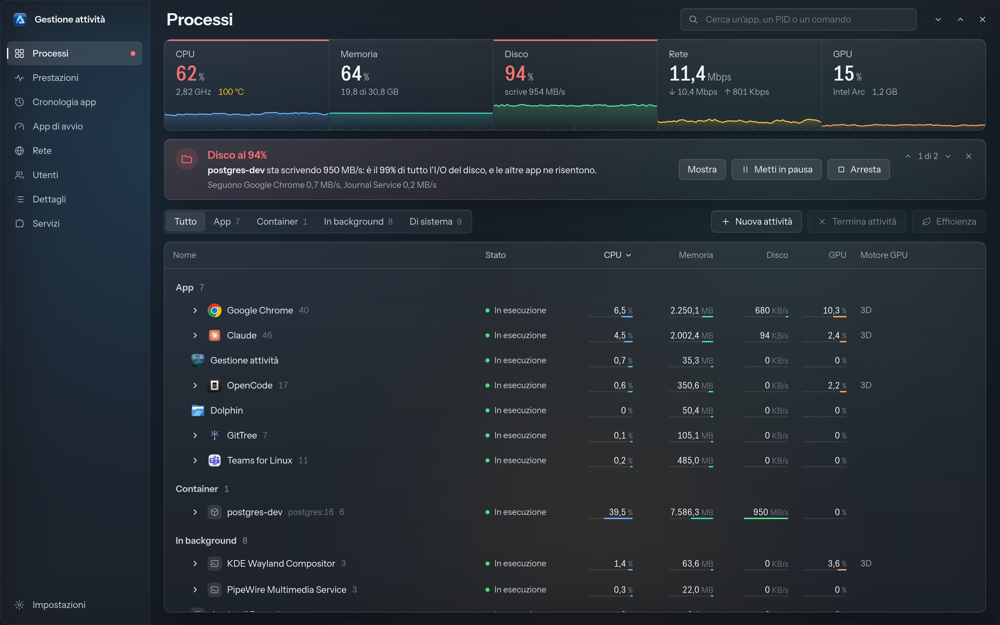
</p>

> The interface is available in **English** and **Italian** (where the app is called *Gestione attività*). It follows the system language and can be changed in Settings.

---

## Why

On Windows, when the computer slows down, you press Ctrl+Alt+Del and within two seconds you can see what is using what. On Linux the tools exist, but they are scattered between the terminal and system monitors, and none of them answers the question that matters: **why** is the disk at 100%?

Activity Manager puts everything into a familiar window, reads the data straight from the kernel and reasons about it:

> **Disk at 97%**: **postgres-dev** is writing 845 MB/s: that's 99% of all disk I/O, and other apps are slowing down.
> &nbsp;&nbsp;&nbsp;&nbsp;`Show` · `Pause` · `Stop`

## Features

**The two Windows shortcuts**
- **Ctrl+Alt+Del** opens a full-screen security screen on every monitor: Lock, Switch user, Sign out, Task Manager, plus Sleep, Restart and Shut down.
- **Ctrl+Shift+Esc** opens the app, or brings it back to the front even when it is minimized (using the Wayland activation token).

**Processes**
- Grouped like on Windows: **Apps**, **Containers** (Docker and Podman, with name and image), **Background** and **System**. Grouping is based on systemd cgroups, so an app with 40 processes stays a single row.
- CPU, memory, disk and GPU per group and per process, with the GPU engine in use (3D, video, copy…).
- Search by name, PID or command line. Sort by any column, with rows gliding into their new position.
- Actions: end task, force end, suspend and resume, **efficiency mode** (lowest CPU and I/O priority), open file location, copy command line, properties. For containers: pause, restart, logs and a shell in the terminal.
- For processes owned by other users it asks for the password through the system dialog (pkexec) instead of failing silently.

**Diagnosis**
- When disk, memory, CPU, temperature or GPU hit the limit, it finds the app responsible, says how much of the total it accounts for and offers the right action: pause a container, put an app in efficiency mode or close it.
- While the app sits in the system tray, it also sends a notification, at most every 30 minutes, with "Ignore for 2 hours".

**Performance**
- Overall and per-core CPU, frequency and temperature; memory and swap; every disk with reads and writes; every network with its Wi-Fi name; every GPU (Intel, AMD, NVIDIA).
- The NVIDIA GPU of hybrid laptops is **never woken up** just to read its state.
- For each resource, the list of who is using it.

**Sensors, like HWiNFO**
- Every sensor of the PC, device by device: CPU package and each core (P-cores and E-cores with their logical CPUs), per-core clocks, GPUs, memory modules, NVMe drives, Wi-Fi card, embedded controller and fans, ACPI thermal zones, battery (voltage, power, wear level, charge cycles).
- Current value, minimum, maximum and average since the app started, with a reset button, warning colors near the limits and a chart for the selected sensor.

**The other pages, as on Windows**
- **App history**: CPU time, disk, GPU and peak memory per app, for today, the last 7 days or the last 30 days (local SQLite).
- **Startup apps**: enable and disable the apps that start at login, the same way KDE System Settings does.
- **Network**: throughput per app and which addresses it talks to, plus the state of the interfaces.
- **Users**: usage per user and their apps.
- **Details**: every process in a flat list, with PID, user, threads, priority and command line.
- **Services**: system and user systemd services; start, stop, restart, start at boot, journal.

**Look and feel**
- Three minimal themes: **Graphite** (dark), **Paper** (light) and **Glass**. Glass uses a transparent window with **real KWin blur** of whatever is behind it (Wayland protocol `ext-background-effect-v1`), not a background picture.
- Window buttons on the right as in KDE, rounded corners with a thin outline.
- English and Italian, from two JSON dictionaries shared by the interface and the backend (`src/locales/en.json`, `src/locales/it.json`).

**Updates**
- Checks the GitHub releases at startup and once a day (can be turned off in Settings). A dot on Settings and, while the app is in the tray, a notification tell you when a new version is out.
- **Update now** downloads the release package, verifies its SHA-256 against the published checksum, makes sure the new binary starts on your system, then installs it and restarts the app. Your settings, shortcuts and start-at-login choice are kept.
- From a terminal: `gestione-attivita --update`.
- Copies installed by a package manager are only notified: the package manager stays in charge.
- Short, polished animations: indicators that glide between items, pages that slide in, rows that reorder, numbers that count up. The ones tied to live updates only run while the window is focused.

**Lightweight**

Measured on the installed app, refreshing every second:

| | CPU usage (Intel Core Ultra 7 155H) |
|---|---|
| Window open and focused, with animations | about 20% of one core |
| Window open, not focused | about 10% |
| Hidden in the system tray | less than 1% |

## Screenshots

The screenshots use demo data.

| | |
|---|---|
| 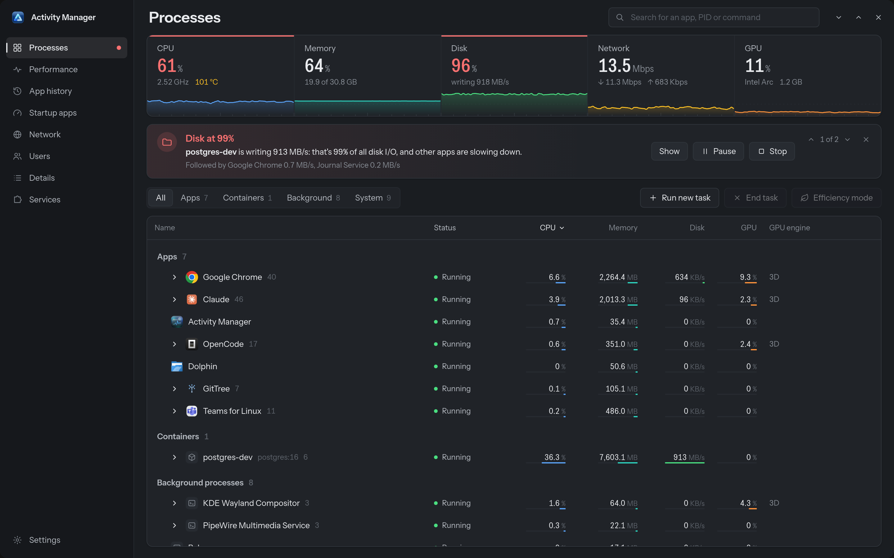 |  |
| **Processes**, Graphite theme | **Performance**, Glass theme |
| 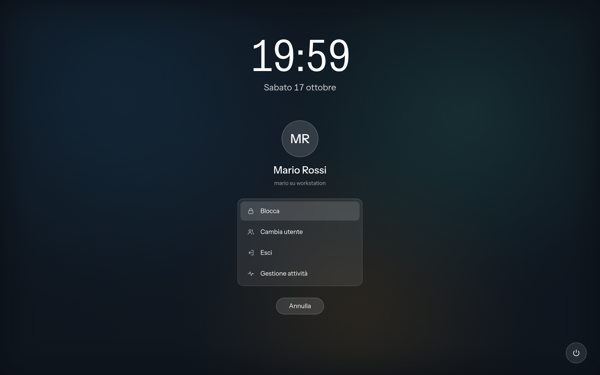 | 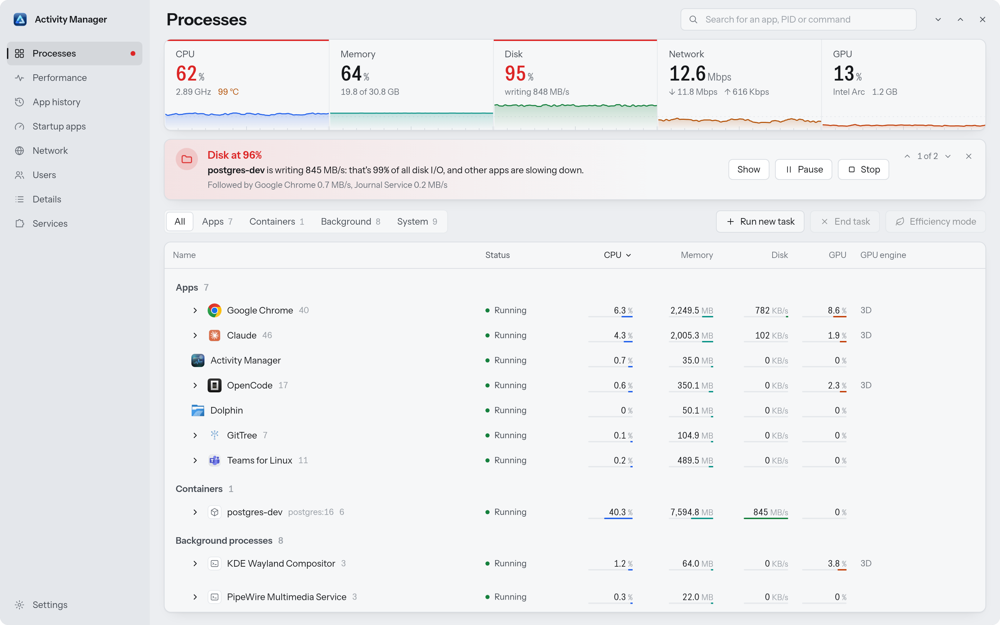 |
| **Ctrl+Alt+Del** | **Processes**, Paper theme |
| 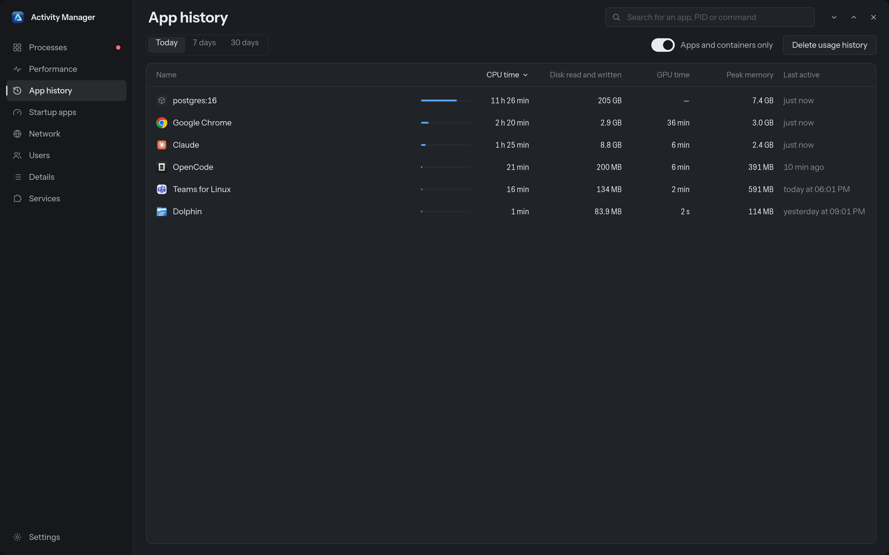 | 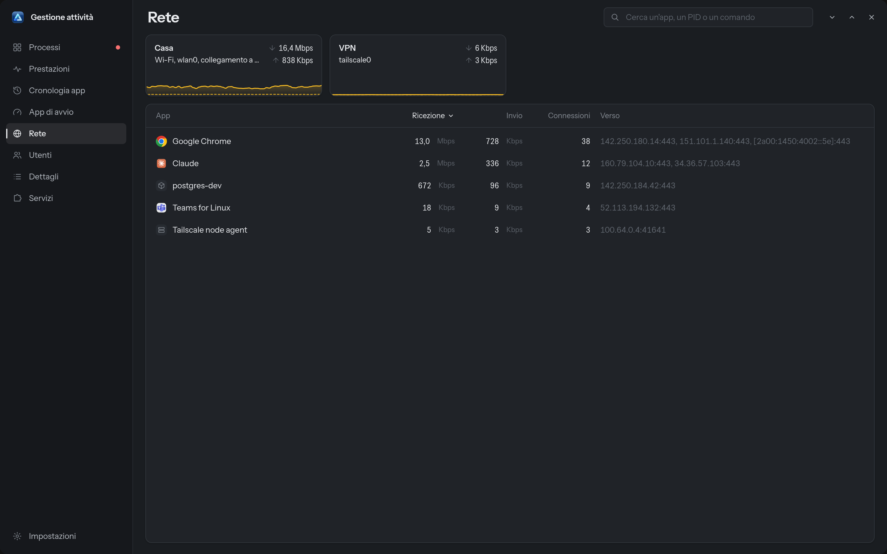 |
| **App history** | **Network** |
| 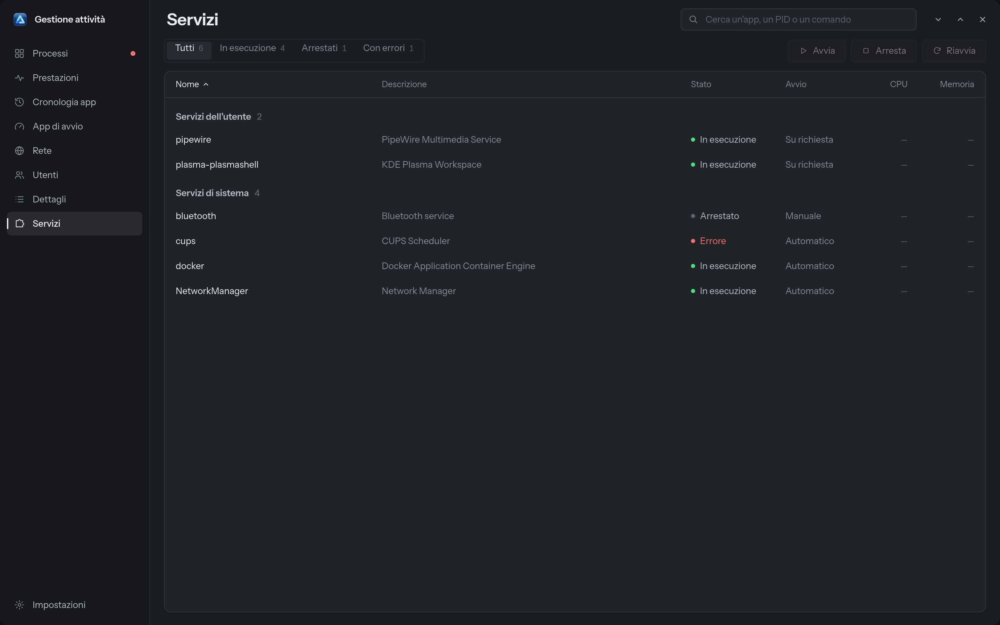 | 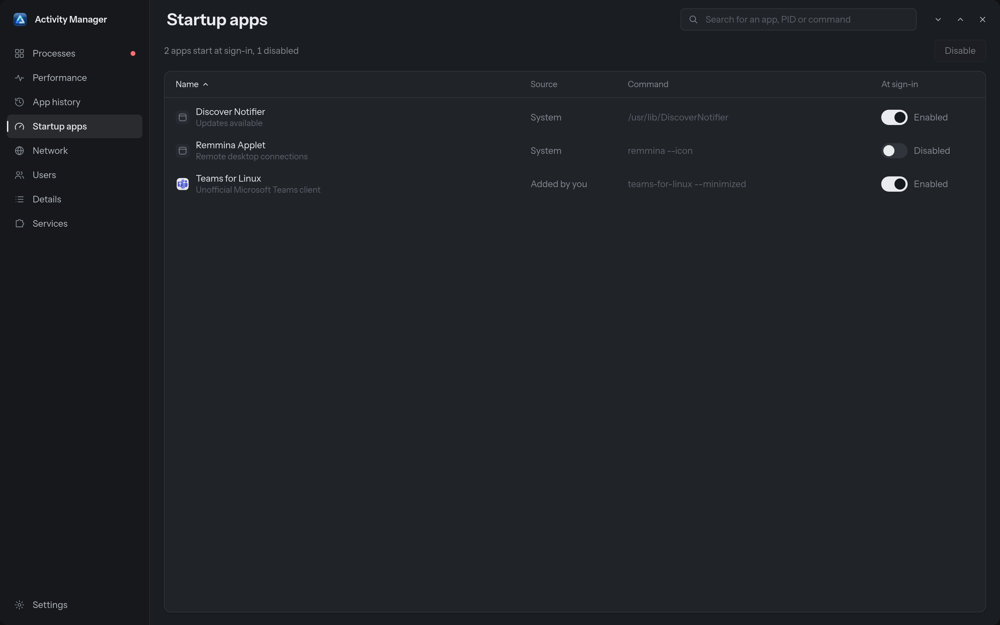 |
| **Services** | **Startup apps** |
|  | 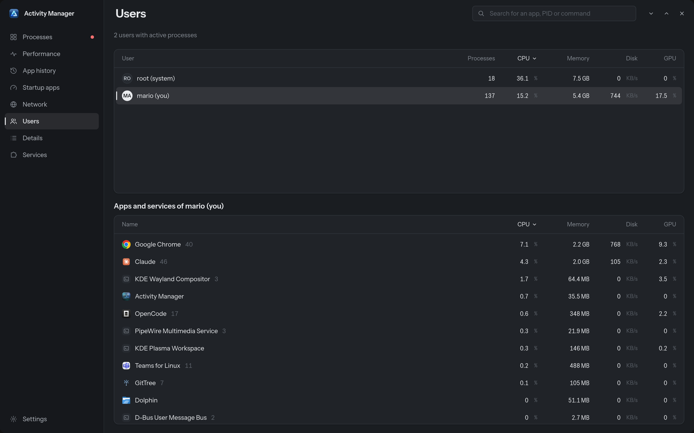 |
| **Details** | **Users** |
| 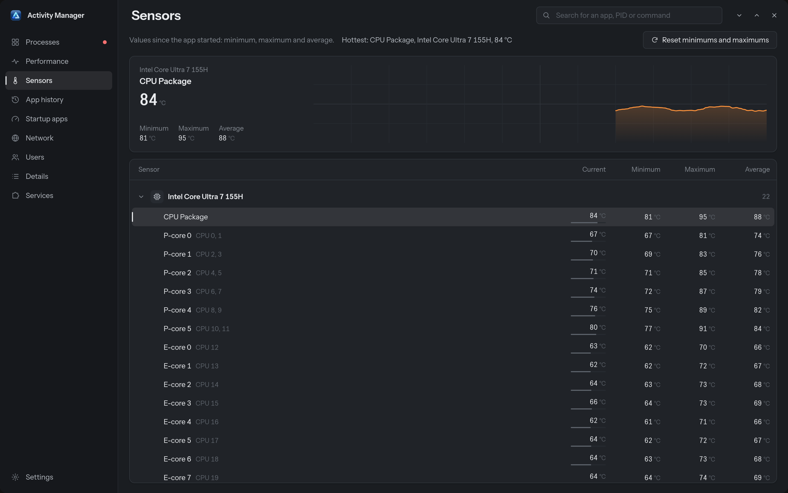 | 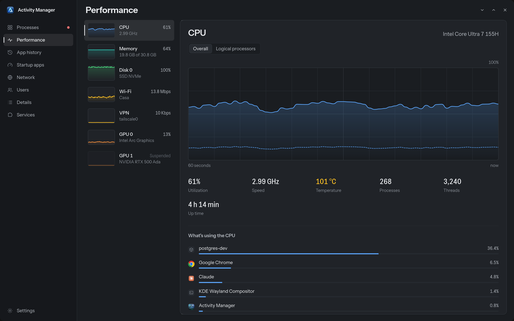 |
| **Sensors** | **Performance**, Graphite theme |
|  | |
| **Settings** | |

## Requirements

- **KDE Plasma 6 on Wayland** (recommended). The global shortcuts and the Glass theme are designed for KDE; everything else works elsewhere too.
- System libraries:

| Distribution | Packages |
|---|---|
| Arch, CachyOS, Manjaro | `webkit2gtk-4.1 gtk3 libayatana-appindicator libnotify` |
| Fedora | `webkit2gtk4.1 gtk3 libayatana-appindicator-gtk3 libnotify` |
| Debian, Ubuntu | `libwebkit2gtk-4.1-0 libgtk-3-0 libayatana-appindicator3-1 libnotify-bin` |

Optional: `docker` or `podman` for containers, `nvidia-utils` for NVIDIA GPU data, `librsvg` for PNG icons.

## Installation

### Arch Linux / CachyOS (AUR)

The `gestione-attivita-bin` package installs the release binary system-wide (`/usr/bin`), with the menu entries and the icon. Its [PKGBUILD](packaging/aur/gestione-attivita-bin/PKGBUILD) is ready to be submitted to the AUR; until it is published there, build it from this repository:

```bash
git clone https://github.com/giannoccarol/Activity-manager-linux.git
cd Activity-manager-linux/packaging/aur/gestione-attivita-bin
makepkg -si
```

Once it is on the AUR, `paru -S gestione-attivita-bin` or `yay -S gestione-attivita-bin` does the same.

Then, as your user, assign the Ctrl+Alt+Del and Ctrl+Shift+Esc shortcuts, and turn on **Start at login** in Settings so Ctrl+Alt+Del responds instantly:

```bash
gestione-attivita --apply-shortcuts
```

Updates come from pacman or your AUR helper: the app only tells you when a new version is out. If you installed it before with `install.sh`, run `./uninstall.sh` from that package first.

### From the release

Release packages are built by GitHub Actions on Ubuntu 24.04 (x86_64) and need glibc 2.39 or newer (Ubuntu 24.04, Fedora 40, Debian 13 and later). On older distributions, build from source.

```bash
tar xf gestione-attivita-2.3.0-linux-x86_64.tar.gz
cd gestione-attivita-2.3.0-linux-x86_64
./install.sh
```

The script installs everything in your home directory, without `sudo`:
- the app in `~/.local/share/gestione-attivita/bin`, with a link in `~/.local/bin`;
- the menu entries and the icon;
- start at login, hidden in the system tray, so Ctrl+Alt+Del responds instantly;
- the Ctrl+Alt+Del and Ctrl+Shift+Esc shortcuts. Ctrl+Alt+Del is taken away from KDE's "Log Out", and a copy of `kglobalshortcutsrc` is kept as a backup.

### From source

You need [Rust](https://rustup.rs) 1.80 or newer, Node.js 20 or newer and the WebKitGTK 4.1 development libraries ([Tauri prerequisites](https://tauri.app/start/prerequisites/)).

```bash
git clone https://github.com/giannoccarol/Activity-manager-linux.git
cd Activity-manager-linux
npm install
npx tauri build
./install.sh
```

### Updating

The app updates itself from **Settings → Updates**, or run `gestione-attivita --update`. Installing a newer package with `./install.sh` works too. The AUR package is updated by pacman or your AUR helper.

### Uninstall

```bash
./uninstall.sh
```

It gives Ctrl+Alt+Del back to KDE's "Log Out". History and settings stay in `~/.local/share/gestione-attivita` and `~/.config/gestione-attivita`.

With the AUR package, run `gestione-attivita --remove-shortcuts` as your user first, then `sudo pacman -R gestione-attivita-bin`.

## How it works

```
┌───────────────────────────── Rust backend ─────────────────────────────┐
│ /proc, cgroup v2, /sys (disks, network, hwmon), DRM fdinfo (GPU)       │
│ systemd, docker/podman, ss, .desktop files and the icon theme          │
│        │                                                               │
│  sampling every second ──► diagnosis ──► lightweight snapshot ─────────┼──► "snapshot" event
│        │                                                               │
│  history (SQLite) · alerts · system tray · KDE shortcuts               │
└────────────────────────────────────────────────────────────────────────┘
                                                          │
┌─────────────────────────── Svelte 5 interface ──────────▼──────────────┐
│ non-deep reactive state ($state.raw) · virtualized tables              │
│ SVG charts · animations on transform and opacity only                  │
└────────────────────────────────────────────────────────────────────────┘
```

- **No extra services**: the app reads the kernel files directly; no privileged daemon is needed.
- **Grouping by app**: every process is traced back to its systemd unit (`app-…scope`, `….service`, `docker-….scope`), then to its `.desktop` file for name and icon.
- **Diagnosis**: for the disk it compares cgroup I/O with the device; for temperature it looks at who is using the CPU; for memory it also considers swap activity.
- **Lightweight**:
  - fields that do not change (name, command line, icon) reach the interface only once;
  - while the window is hidden, sampling slows down to once every 3 seconds;
  - long tables only render the visible rows;
  - there are no infinite animations, because with the Glass theme KWin would recompute the blur on every frame.
- **Wayland**: the Ctrl+Alt+Del screen goes full screen on every monitor through GTK; the blur uses `ext-background-effect-v1`; the activation token (`XDG_ACTIVATION_TOKEN`) is passed from the new instance to the one already running.

## Development

```bash
npm run dev          # interface in the browser with demo data (http://localhost:1420)
npx tauri dev        # full app with real data
```

Useful command line options:

| Option | Effect |
|---|---|
| `--tray` | start hidden in the system tray |
| `--secure` | open the Ctrl+Alt+Del screen |
| `--dump` | print a JSON snapshot of the data and exit |
| `--sensors` | print every sensor, device by device, as JSON |
| `--bench` | measure smoothness, page switching, search, scrolling and CPU usage; results in `~/.cache/gestione-attivita/bench.txt` |
| `--apply-shortcuts`, `--remove-shortcuts` | assign or remove the KDE shortcuts |
| `--version` | print the version |
| `--check-update`, `--update` | check for a new version, or download and install it |

Layout:

```
src/                 interface (Svelte 5, TypeScript)
  pages/             one page per menu entry, plus the Ctrl+Alt+Del screen
  components/        process table, charts, menus, dialogs…
  lib/               state, i18n, number formatting, animations, benchmark
  locales/           en.json and it.json: every string of the interface and the backend
src-tauri/src/
  collect/           processes, system (CPU, memory, disks, network), GPU
  extra/             app history, per-app network, startup apps, services
  insights.rs        diagnosis ("why is it at 100%")
  actions.rs         end, suspend, efficiency mode, containers…
  blur.rs            real KWin blur
  session.rs         lock, switch user, sign out, power
  settings.rs        settings, KDE shortcuts, autostart
  update.rs          update check, download, checksum, installation
  sensors.rs         hardware sensors device by device, min/max/average
packaging/           release package (package.sh, verify.sh, README.txt) and the AUR package
```

### Releases

Release packages are built by GitHub Actions. Pushing a tag `vX.Y.Z` runs [`release.yml`](.github/workflows/release.yml): it checks that the tag matches the version in `package.json`, `src-tauri/Cargo.toml` and `src-tauri/tauri.conf.json`, builds on Ubuntu 24.04, assembles the package with `packaging/package.sh`, checks it the way the in-app updater will (`packaging/verify.sh`: checksum file, layout, `--version`) and attaches it with its `.sha256` to the GitHub release of the tag, creating the release if needed. Every push and pull request is built by [`ci.yml`](.github/workflows/ci.yml), which also builds the AUR package and checks it with namcap. Updating the AUR package after a release is described in [packaging/aur](packaging/aur/README.md).

## Privacy

Everything stays on your computer. The only network request is the update check: once a day the app asks the GitHub API for the latest release of this repository, and downloads the package when you choose to update. No other data is sent, and the check can be turned off in Settings. The history is a SQLite file in `~/.local/share/gestione-attivita/history.sqlite`.

## License

Activity Manager is free software, released under the [GNU General Public License v3.0 or later](LICENSE).
